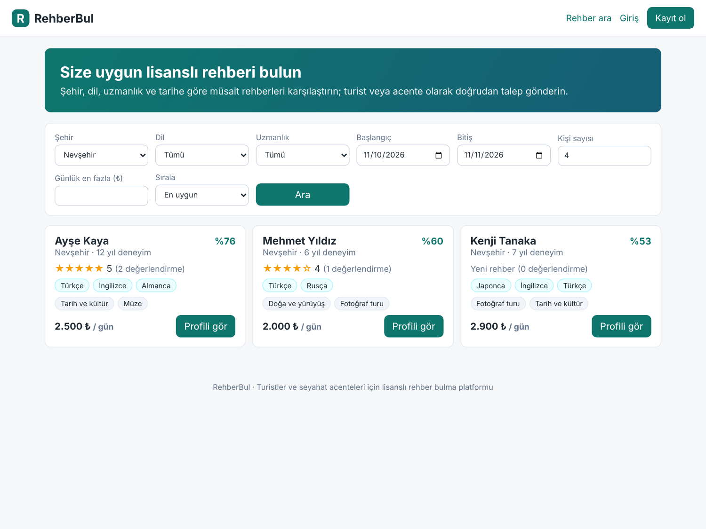
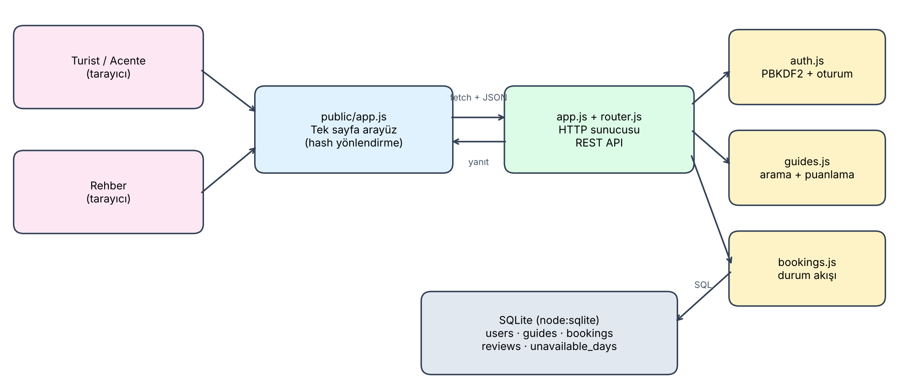
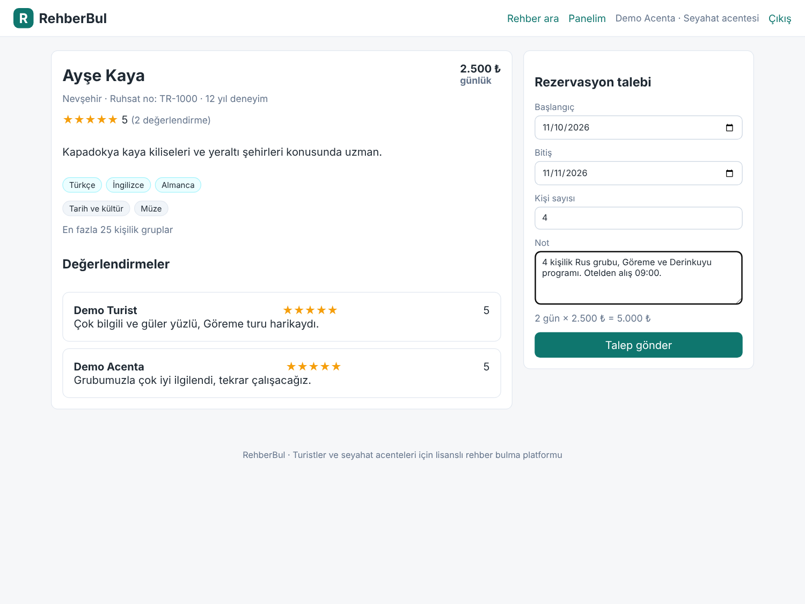
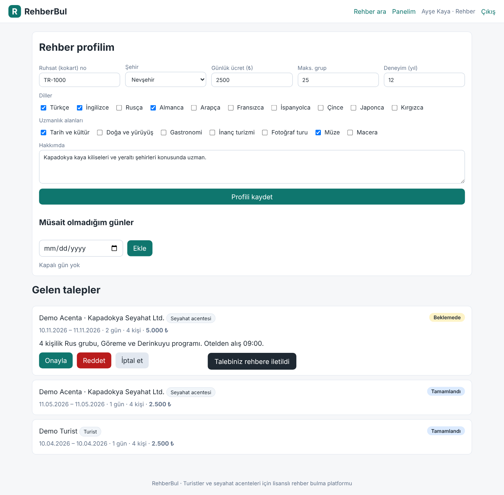

# RehberBul

Turistler ve seyahat acenteleri için **lisanslı turist rehberi bulma ve rezervasyon** platformu.

Turist veya acente; şehir, dil, uzmanlık alanı, tarih, grup büyüklüğü ve bütçeye göre **o tarihlerde müsait** rehberleri arar,
eşleşme puanına göre sıralanmış sonuçları karşılaştırır ve rehbere doğrudan rezervasyon talebi gönderir.
Rehber kendi profilini ve kapalı günlerini yönetir, gelen talepleri onaylar veya reddeder. Tamamlanan turlar değerlendirilir.



## Özellikler

- **Üç hesap türü:** turist, seyahat acentesi (acenta adıyla), rehber
- **Akıllı arama:** şehir, dil, uzmanlık, tarih aralığı, grup büyüklüğü, günlük ücret filtresi
- **Müsaitlik kontrolü:** rehberin kapalı günleri ve onaylanmış rezervasyonlarıyla çakışan rehberler listelenmez
- **Eşleşme puanı (0–100):** %40 değerlendirme puanı, %25 uzmanlık uyumu, %20 deneyim, %15 fiyat uygunluğu
- **Rezervasyon akışı:** beklemede → onaylandı / reddedildi / iptal → tamamlandı; çakışan talepler onaylanamaz
- **Değerlendirme:** yalnızca tamamlanmış tur için, tur başına bir kez
- **Güvenlik:** PBKDF2 (SHA-256) ile şifre özeti, rastgele oturum anahtarı, parametreli SQL sorguları,
  istek boyutu sınırı, statik dosyalarda dizin dışına çıkma koruması
- **Sıfır bağımlılık:** yalnızca Node.js yerleşik modülleri (`node:http`, `node:sqlite`, `node:crypto`, `node:test`)

## Kurulum

Gereksinim: **Node.js 22.5 veya üstü**

```bash
git clone https://github.com/KULLANICI_ADI/rehberbul.git
cd rehberbul
npm run seed     # demo verisini yükler
npm start        # http://localhost:3000
```

Demo hesaplar (şifre `demo1234`): `turist@demo.com`, `acenta@demo.com`, `rehber@demo.com`

## Testler

```bash
npm test
```

14 test: arama filtreleri, müsaitlik, eşleşme puanı, ücret hesabı, çakışan rezervasyonlar,
yetki kontrolleri, durum geçişleri, değerlendirme kuralları ve uçtan uca HTTP API akışı.

## Mimari



```
src/
  server.js            giriş noktası
  app.js               HTTP sunucusu, uç noktalar, statik dosyalar
  router.js            :parametreli yol eşleştirici
  db.js                SQLite şeması ve transaction yardımcısı
  auth.js              kayıt, giriş, oturum
  validation.js        girdi doğrulama, tarih yardımcıları
  services/guides.js   rehber profili, arama, eşleşme puanı, müsaitlik
  services/bookings.js rezervasyon talebi, durum geçişleri, değerlendirme
  seed.js              demo verisi
public/                tek sayfa arayüz (HTML, CSS, JS)
tests/                 node:test birim ve entegrasyon testleri
```

## API

| Yöntem | Yol | Açıklama |
|---|---|---|
| POST | `/api/auth/register` | Kayıt (`role`: turist / acenta / rehber) |
| POST | `/api/auth/login` | Giriş, oturum anahtarı döner |
| GET | `/api/me` | Oturumdaki kullanıcı (ve rehber profili) |
| GET | `/api/guides` | Arama: `city, language, specialty, start, end, groupSize, maxPrice, sort` |
| GET | `/api/guides/:id` | Rehber profili ve değerlendirmeler |
| PUT | `/api/guides/me` | Rehber profilini oluştur / güncelle |
| POST | `/api/guides/me/unavailable` | Kapalı gün ekle / kaldır |
| GET | `/api/bookings` | Kullanıcının rezervasyonları / rehberin gelen talepleri |
| POST | `/api/bookings` | Rezervasyon talebi |
| POST | `/api/bookings/:id/{accept,decline,cancel,complete}` | Durum değiştir |
| POST | `/api/bookings/:id/review` | Tamamlanan turu değerlendir |

## Ekran görüntüleri

| Rehber profili ve talep formu | Rehber paneli |
|---|---|
|  |  |

## Lisans

MIT
